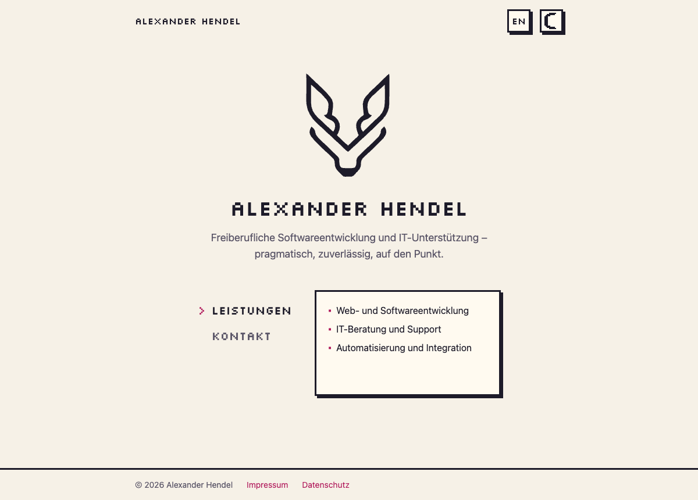
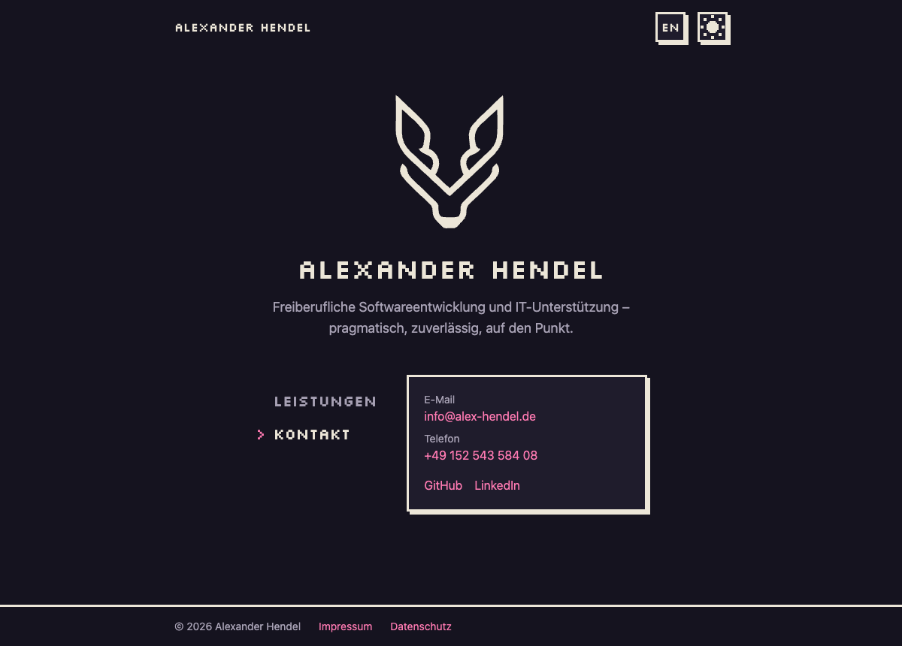

<p align="center">
  <picture>
    <source media="(prefers-color-scheme: dark)" srcset="docs/assets/logo-dark.svg">
    
  </picture>
</p>

<h1 align="center">alex-hendel.de</h1>

<p align="center">
  Website of <strong>Alexander Hendel Software Entwicklung</strong>, freelance software development and IT support.<br>
  Pixel art, two languages, no tracking.
</p>

<p align="center">
  <a href="https://alex-hendel.de">alex-hendel.de</a> ·
  <a href="docs/README.md">Docs</a> ·
  <a href="docs/deployment.md">Deployment</a>
</p>

| Light | Dark |
|-------|------|
|  |  |

## Features

- **Pixel logo:** fades in from coarse pixels on load and pixelates again on hover
- **Zelda-style menu:** pick "Leistungen" or "Kontakt" with mouse, touch or arrow keys; the details slide out
- **Light and dark theme** with a pixel sun/moon toggle
- **German and English**, with a pixel `DE`/`EN` switch that keeps you on the same page
- **Soft page transitions** (CSS View Transitions)
- **DSGVO-friendly:** no cookies, no analytics, no third-party requests, self-hosted font
- **Accessible:** keyboard support, reduced-motion support, works without JavaScript

## Stack

[Astro](https://astro.build) 7 (static output) · Tailwind CSS 4 · TypeScript · content as Markdown and JSON · GitHub Pages

## Getting started

Requires [mise](https://mise.jdx.dev) for the toolchain (Node 24, pnpm 12.14.0).

```sh
mise trust && mise install
pnpm install
pnpm dev        # http://localhost:4321
```

| Command | What it does |
|---------|--------------|
| `pnpm dev` | Start the dev server |
| `pnpm build` | Type check, then build the static site into `dist/` |
| `pnpm preview` | Serve the built site locally |

## Editing content

All texts live in [`src/content/`](src/content/):

- `site.json`: pitch, services and labels in German and English
- `contact.json`: email, phone, profile links
- `legal/{de,en}/`: Impressum and Datenschutz as Markdown

Schemas check the content at build time. See [docs/content.md](docs/content.md) for examples.

## Deployment

Every push to `main` builds and deploys the site to GitHub Pages through [`.github/workflows/deploy.yml`](.github/workflows/deploy.yml). First-time setup, DNS records and troubleshooting are in [docs/deployment.md](docs/deployment.md).

## Documentation

| | |
|---|---|
| [Overview](docs/README.md) | What the site is, status, launch checklist |
| [Requirements](docs/requirements.md) | User stories and acceptance criteria |
| [Architecture](docs/architecture.md) | Stack, repo layout, routing, content model |
| [Interactions](docs/interactions.md) | Pixel logo, menu, toggles, transitions |
| [Content](docs/content.md) | How to edit texts and legal pages |
| [Deployment](docs/deployment.md) | Local setup, CI, GitHub Pages, DNS |
| [Compliance](docs/compliance.md) | DSGVO and legal notes |
| [Decisions](docs/DECISIONS.md) | Why things are the way they are |

## License

The code and docs are under the [MIT License](LICENSE): copy, change and reuse them freely, as long as you keep the copyright notice.

**The logo is excluded.** It is my property and all rights are reserved; see [NOTICE.md](NOTICE.md). If you build on this project, swap in your own logo.
